# ClusterHop — Workflow and Architecture

## Purpose

ClusterHop connects a GitHub repository to an existing GitLab CI/CD pipeline. It transfers the
exact GitHub commit, starts the intended GitLab pipeline, monitors its jobs, and reports the final
result back to GitHub Actions.

ClusterHop does not replace GitLab CI or an HPC scheduler. GitLab defines the jobs and selects its
runners; ClusterHop coordinates the workflow between GitHub and GitLab.

## End-to-End Workflow

```mermaid
flowchart LR
    A[Developer pushes to GitHub] --> B[GitHub Actions]
    B --> C[ClusterHop Docker Action]
    C --> D[Keyloom loads credentials]
    D --> E[Push exact commit to GitLab]
    E --> F[Trigger GitLab pipeline]
    F --> G[GitLab runner executes jobs]
    G --> H[ClusterHop monitors results]
    H --> I[GitHub summary and exit status]
```



1. A developer pushes a commit to GitHub, and a GitHub Actions workflow starts.
2. The workflow invokes the reusable ClusterHop Docker Action with the GitLab URL, GitLab project,
   encrypted secrets file, and optional machine preset.
3. The Action prepares the flat ClusterHop configuration and runtime options for the checked-out
   repository.
4. The CLI uses `CLUSTERHOP_SECRETS_PASSWORD` to load the Keyloom-encrypted GitLab access and
   trigger tokens in memory. The password and decrypted credentials are not written to generated
   configuration files or pipeline state.
5. ClusterHop validates the destination, resolves authoritative GitLab project information, checks
   the repository and commit, and validates all required credentials and options before the run.
6. ClusterHop securely pushes the exact GitHub commit to `ci/<github-commit-sha>`. The push uses
   GitLab's `ci.skip` option so transferring the commit does not start an unintended duplicate
   pipeline.
7. ClusterHop explicitly calls the GitLab Pipeline Trigger API for that branch. This separates
   commit transfer from pipeline creation and allows GitHub metadata and configured trigger
   variables to be supplied deliberately.
8. Optional `preset_machine` configuration dynamically adds a variable such as
   `CLUSTERHOP_JURECA_RUN=true`. Preset names are validated; ClusterHop does not maintain a
   hardcoded preset list. Other custom trigger variables can be supplied separately.
9. A GitLab runner executes the jobs defined by the target project's `.gitlab-ci.yml`. A JURECA
   Jacamar Shell runner is one validated deployment example, not a requirement for every ClusterHop
   installation.
10. ClusterHop polls the pipeline until it reaches a terminal state or the configured timeout. It
    collects every job result and safely decodes available logs, removing terminal control
    sequences and enforcing the summary size limit.
11. ClusterHop writes the overall pipeline status and all jobs to the GitHub Actions summary. A
    small log may be embedded for a single-job pipeline; multi-job pipelines use per-job GitLab
    links instead of selecting a preferred job.
12. The final ClusterHop status becomes the Action process exit status, so success or failure is
    returned to the originating GitHub workflow.

## Timeout and Cancellation

Once GitLab creates a pipeline, ClusterHop atomically records non-secret pipeline state. On timeout,
it makes one bounded cancellation request while keeping the final result `timeout`.

During normal execution, `SIGINT` and `SIGTERM` request idempotent cleanup. If the main process is
terminated before cleanup completes, the Docker Action post-entrypoint reads the persisted state and
performs bounded best-effort fallback cancellation. Missing or inactive state is a safe no-op, and
failed cleanup leaves active state available for a later retry.

Forced runner loss can prevent any cleanup process from running, so cancellation is best effort
rather than an absolute guarantee.

## Supported Interfaces

### Python API

```python
result = clusterhop.run(config=config, repo_path=repo_path, options=options, secrets=secrets)
```

The current destination implementation is GitLab. The call returns a structured result containing
the status, exit code, summary, and a sanitized error message when applicable.

### Command-Line Interface

```text
clusterhop run --config config.yaml --options options.yaml REPO_PATH --secrets secrets.yaml
```

The CLI loads the flat YAML inputs and calls the same public Python API. `--options` is optional.
The legacy positional `clusterhop run SOURCE_FILE DESTINATION_NAME` behavior remains supported.

### Reusable GitHub Action

The Docker Action is the recommended GitHub Actions integration. Its inputs are `gitlab-url`,
`gitlab-project`, optional `preset-machine`, and `secrets-file`; `CLUSTERHOP_SECRETS_PASSWORD` is
provided through the step environment from GitHub Actions Secrets. Pin the Action to an immutable
released reference or commit according to the project's release policy.

## Main Components

- **ClusterHop public API and CLI:** validate inputs and start the GitHub-to-GitLab runner.
- **Keyloom:** decrypts explicitly marked credentials; it does not run Git or GitLab pipelines.
- **Git layer:** verifies and securely transfers the requested commit without embedding credentials
  in the remote URL.
- **GitLab client:** resolves the project, triggers and monitors pipelines, retrieves jobs and logs,
  and requests cancellation.
- **Runner and summary layer:** coordinate the lifecycle, persist non-secret state, and return the
  final result to GitHub.

Example flat configuration, options, and placeholder secrets files are available under
`examples/github2lab/`.
